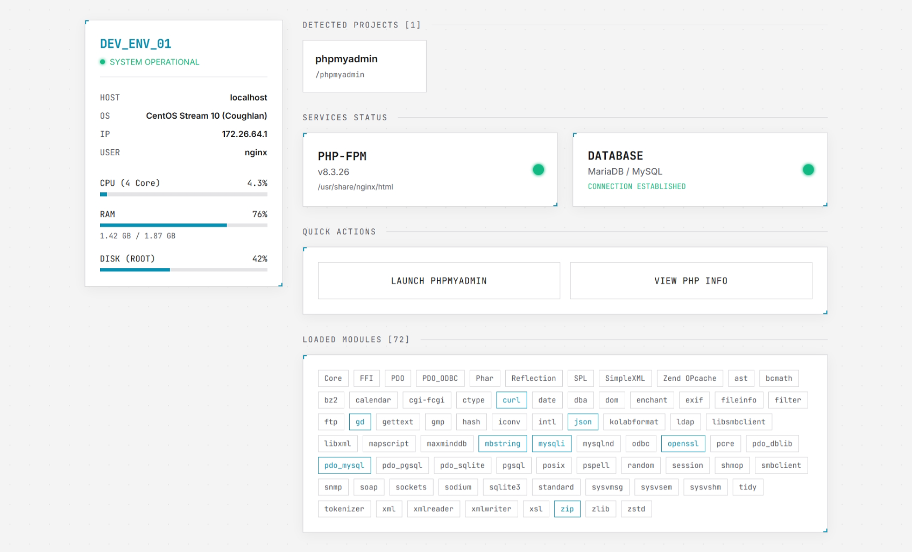
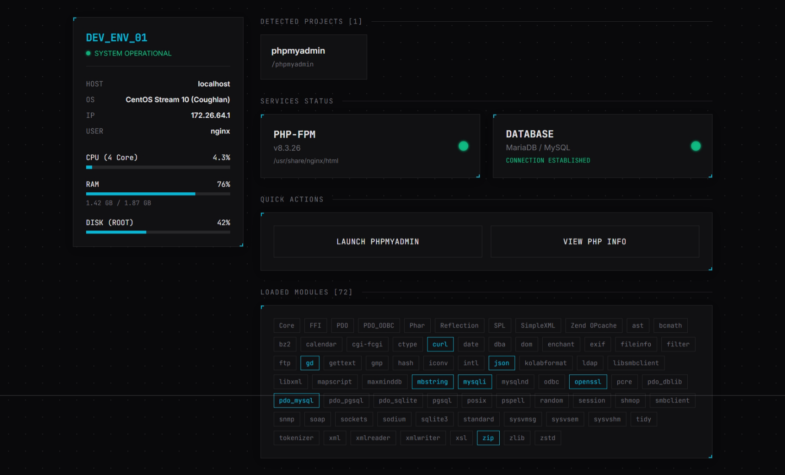
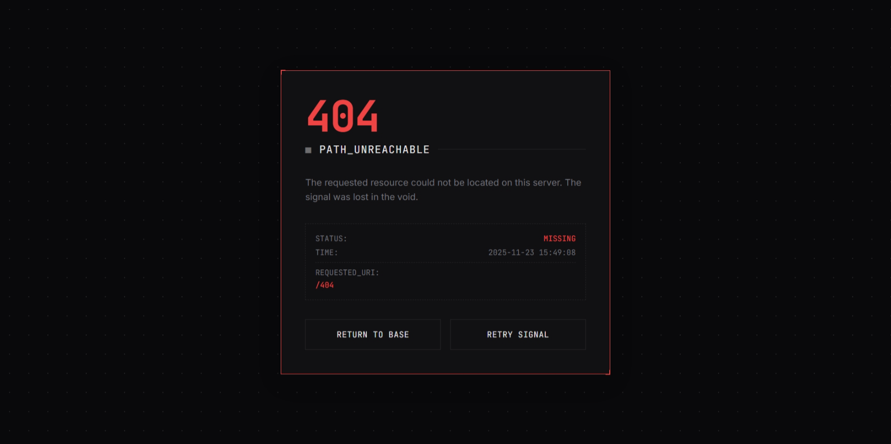
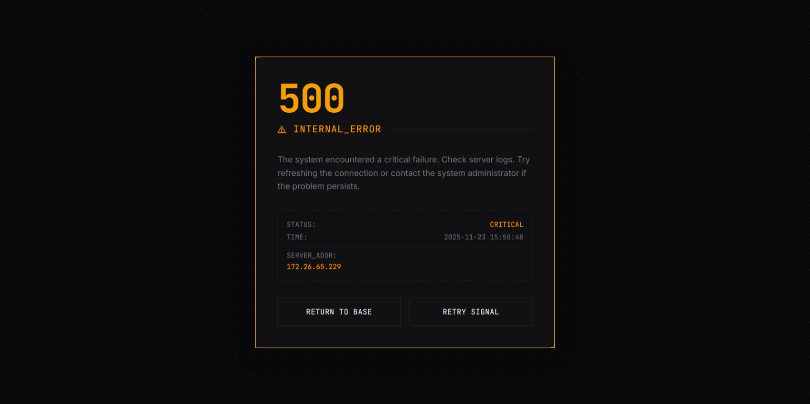

# 🚀 DEV_ENV Dashboard

**Localhost Rasa Production.**
Sebuah dashboard modern, ringan, dan *powerful* untuk menggantikan halaman default `localhost` (seperti XAMPP/WAMP/MAMP) yang membosankan.

Didesain khusus untuk **LEMP/LAMP Stack** (Linux, Nginx/Apache, MySQL, PHP) dengan gaya visual **Cyber Industrial**.



## 🔥 Fitur Unggulan

Bukan sekadar halaman HTML statis. Dashboard ini "hidup":

* **📂 Auto-Scan Project:** Gak perlu edit HTML manual. Cukup `mkdir` folder baru di root, refresh, langsung muncul tombolnya.
* **📊 Real-Time System Monitor:** Membaca langsung Kernel Linux (`/proc/`) untuk menampilkan penggunaan **CPU, RAM, dan Disk** secara akurat.
* **🚦 Service Health Check:** Otomatis mengecek status koneksi ke **Database (MySQL/MariaDB)** dan service PHP via socket ping.
* **🎨 Auto-Theme & Responsive:** Otomatis mendeteksi mode Gelap/Terang OS (Dark/Light Mode). Layout menggunakan CSS Grid yang solid di Desktop maupun Mobile.
* **🛡️ Security First:** Proteksi XSS, path traversal filter, dan tombol `phpinfo()` yang terkunci untuk akses publik.
* **⛔ Custom Error Pages:** Termasuk template halaman error **404, 403, dan 50x** yang seragam dan estetik.

## 🛠️ Persyaratan

* **PHP:** Versi 8.0 ke atas.
* **OS:** Dioptimalkan untuk **Linux** (RHEL, CentOS, Ubuntu, Debian) untuk fitur monitoring CPU/RAM.
    * *Bisa jalan di Windows (XAMPP/Laragon), tapi fitur monitoring CPU/RAM akan otomatis mati (N/A).*
* **Web Server:** Nginx (Recommended) atau Apache.

## 📦 Cara Install

### 1. Copy File
Copy semua file (`index.php`, `40x.php`, `50x.php`) ke root direktori web server kamu.
* **Nginx:** `/usr/share/nginx/html/` atau `/var/www/html/`
* **XAMPP:** `C:\xampp\htdocs\`

### 2. Konfigurasi Nginx (PENTING!)
Agar halaman error custom (404, 403, 50x) berjalan dengan benar dan tidak bentrok dengan script PHP, tambahkan konfigurasi berikut di blok `server { ... }` Nginx kamu:

```nginx
# Error Pages Definition
error_page 404 /404.php;
error_page 403 /403.php;
error_page 500 502 503 504 /50x.php;

# Jalur Khusus Error Page (Wajib 'internal')
location = /404.php {
    root /usr/share/nginx/html;
    internal;
    fastcgi_pass   unix:/var/run/php-fpm/www.sock; # Sesuaikan socket PHP kamu
    fastcgi_index  index.php;
    fastcgi_param  SCRIPT_FILENAME $document_root$fastcgi_script_name;
    include        fastcgi_params;
}

location = /403.php {
    root /usr/share/nginx/html;
    internal;
    error_page 404 /404.php;
    fastcgi_pass   unix:/var/run/php-fpm/www.sock;
    fastcgi_index  index.php;
    fastcgi_param  SCRIPT_FILENAME $document_root$fastcgi_script_name;
    include        fastcgi_params;
}

location = /50x.php {
    root /usr/share/nginx/html;
    internal;
    error_page 404 /404.php;
    fastcgi_pass   unix:/var/run/php-fpm/www.sock;
    fastcgi_index  index.php;
    fastcgi_param  SCRIPT_FILENAME $document_root$fastcgi_script_name;
    include        fastcgi_params;
}

# Dan pastikan di location PHP utama ada intercept
location ~ \.php$ {
    # ... config lain ...
    fastcgi_intercept_errors on; # <--- INI KUNCINYA
}
````

### 3\. Restart Server

```bash
sudo systemctl restart nginx
# atau
sudo systemctl restart php-fpm
```

## ⚙️ Kustomisasi

### Menambah Folder yang Diabaikan

Buka `index.php`, cari variabel `$ignored`. Tambahkan nama folder yang tidak ingin ditampilkan di dashboard:

```php
$ignored = ['.', '..', 'html', 'images', 'private_folder', 'git'];
```

### Menambah Highlight Modul PHP

Buka `index.php`, cari variabel `$priority`. Tambahkan ekstensi PHP yang ingin kamu highlight:

```php
$priority = ['mysqli', 'curl', 'gd', 'redis', 'imagick'];
```

## 📷 Screenshots

| Dashboard (Dark) | Error 404 (Red) | Error 500 (Orange) |
| --- | --- | --- |
|  |  |  |

## 📝 License

Project ini open-source di bawah lisensi **Common Development and Distribution License (CDDL)**. Bebas dipake, dioprek, atau dijadiin bahan pamer ke temen kantor.

-----

*Crafted with ☕ and CSS Grid.*
